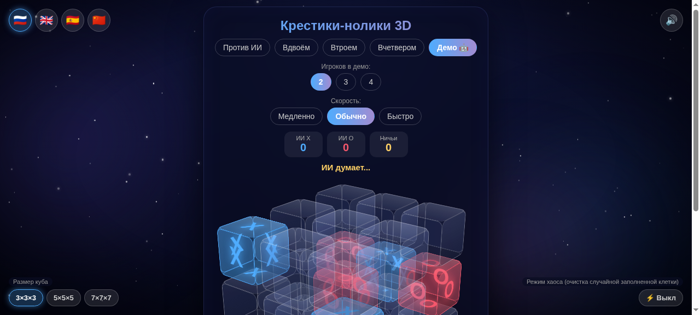

# Tic-Tac-Toe 3D / 三维井字棋



Three-dimensional tic-tac-toe in a single HTML file. No dependencies — open `index.html` in any browser.

Трёхмерная «крестики-нолики» в одном HTML-файле. Без зависимостей — откройте `index.html` в любом браузере.

## Features / Возможности

- 🎲 Board sizes **3×3×3, 5×5×5, 7×7×7** — win: N in a row on any line (including space diagonals)
- 🤖 Modes: **Vs AI** (minimax on 3×3×3), **2, 3 (▲) or 4 (□) players**
- 🤖🤖 **Demo mode** — AI plays against itself (2–4 players), adjustable speed, auto-restart
- ⚡ **Chaos mode** — a random *filled* cell is cleared periodically (frequency: rare / medium / frequent)
- 🌌 Space background: stars, nebulae, vignette
- 🔊 Move / win / draw / chaos sounds (Web Audio API, no audio files)
- 🌍 UI languages: 🇷🇺 Russian, 🇬🇧 English, 🇪🇸 Spanish, 🇨🇳 Chinese
- 🖱 Cube rotation by drag, auto-rotation, touch controls

## Run / Запуск

Just open `index.html`.

## Android (APK)

The `android/` folder contains an Android Studio project: the game is loaded in a WebView from `assets/index.html`.

1. Open the `android/` folder in Android Studio
2. **Build → Build App Bundle(s)/APK(s) → Build APK(s)**
3. Result: `app/build/outputs/apk/debug/app-debug.apk`

> Keep a copy of the game at `android/app/src/main/assets/index.html` in sync with the root `index.html`.

## Controls / Управление

| Action / Действие | How / Как |
|---|---|
| Move / Ход | Click/tap a cube / Клик/тап по кубику |
| Rotate / Вращение | Drag the scene / Перетаскивание сцены |
| Language / Язык | Flags 🇷🇺🇬🇧🇪🇸🇨🇳 (top-left / верх-лево) |
| Board size / Размер поля | 3×3×3 / 5×5×5 / 7×7×7 (bottom-left / низ-лево) |
| Chaos / Хаос | ⚡ On/Off + frequency / Вкл + частота (bottom-right / низ-право) |
| Sound / Звук | 🔊 (top-right / верх-право) |

## AI / ИИ

- **2 players, 3×3×3** — minimax with alpha-beta pruning (depth 3–4) + center bonus
- **2 players, 5×5×5 / 7×7×7** — heuristic: win → block → create/suppress "N−1 in a row" threats → center
- **3–4 players** — heuristic accounting for all opponents' threats (blocking two threats with one move is valued higher)

## Structure / Структура

```
├── index.html        — the game (self-contained HTML + CSS + JS)
├── README.md
└── android/          — Android Studio project for building APK
    └── app/src/main/
        ├── AndroidManifest.xml
        ├── assets/index.html        — copy of the game
        └── java/com/example/tictactoe/MainActivity.kt
```

## License / Лицензия

MIT — use it however you like.